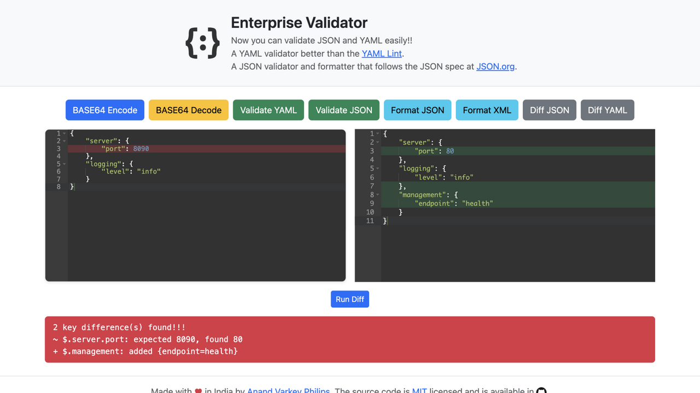

# Enterprise Validator


[](https://central.sonatype.com/artifact/com.github.anandvarkeyphilips/enterprise-validator)
[](https://github.com/anandvarkeyphilips/enterprise-validator/actions/workflows/ci.yml)
[](https://github.com/anandvarkeyphilips/enterprise-validator/issues)
[](https://github.com/anandvarkeyphilips/enterprise-validator/network)
[](LICENSE)

A self-contained Spring Boot application for enterprises that cannot use public websites for data
validation and manipulation — everything runs locally, no external services are called.

*Originally developed 2018–2021; revived and fully modernized in November 2026 — Java 25, Spring Boot 3.5,
CVE remediation across the dependency tree, OIDC-based CI/CD, Playwright end-to-end tests and the
Bootstrap 5 UI redesign you see in the screenshot.*

**Java 25 LTS** · **Spring Boot 3.5.16** · **≥ 90% coverage & mutation gates** · **17 Playwright e2e specs** · **OIDC CI/CD → Azure** · **releases on Maven Central**

**Try it live:** https://enterprise-validator.azurewebsites.net/editor



## Features

* **YAML validation** following the YAML spec, including multi-document (`---`) support that
  http://www.yamllint.com does not offer — with line and column markers on the failing key.
* **JSON validation and formatting** per the JSON spec at http://json.org/.
* **XML formatting** with pretty printing.
* **Base64 encoding and decoding** — no need for https://www.base64decode.org/.
* **Share** the editor content by copying it to the clipboard or opening a pre-filled email.
* **OpenAPI / Swagger UI** documentation of every endpoint at `/swagger-ui.html`.

## Engineering practices

This repo is deliberately run like a production service, not a demo. Everything below is wired
into the build and CI — nothing is aspirational.

**Reviewing the repo? Five-minute tour:** the quality gates live in
[`pom.xml`](pom.xml) (JaCoCo and PIT thresholds, formatter), unit tests in
[`src/test`](src/test/java/io/exnihilo/validator), browser e2e in
[`e2e/tests/editor.spec.ts`](e2e/tests/editor.spec.ts), the whole pipeline — including the OIDC
deploy and Maven Central publishing — in [`.github/workflows/ci.yml`](.github/workflows/ci.yml),
and the modernization story in `git log` since November 2026.

### Automated quality gates (the build fails without them)

| Gate | Tooling | Threshold |
| --- | --- | --- |
| Unit & integration tests | JUnit 5, Mockito, AssertJ, EqualsVerifier | all green |
| Line coverage | JaCoCo, enforced in `mvn verify` | ≥ 90% |
| Mutation testing | PIT (pitest-maven), enforced in `mvn verify` | ≥ 90% mutants killed |
| Code formatting | google-java-format via formatter-maven-plugin | applied on every build |
| Browser end-to-end | Playwright, 17 specs driving the real packaged jar | all green |
| API regression | Postman collection, runnable with Newman against any deployment | on release |

A note on **mutation testing**, the strongest of these gates: PIT mutates the production bytecode
(flips boolean conditions, swaps numeric returns, removes method calls) and re-runs the tests
against every mutant. If a mutant survives, no test can tell the difference — meaning the tests
look thorough but aren't actually pinning the behaviour. Requiring 90% of mutants killed proves
the test suite detects real logic changes, not just that lines were executed.

### CI/CD on GitHub Actions

* One pipeline job runs verify → Playwright e2e → deploy → live smoke test, with no stored
  artifacts (the jar never leaves the runner except to Azure).
* **Deploy uses OpenID Connect federation** — no Azure passwords or client secrets anywhere;
  a federated credential scoped to this repository's `master` branch and `production`
  environment, holding *Website Contributor* on a single resource group.
* Pushing a `v*` tag **publishes to Maven Central** (GPG-signed, sources + javadoc attached,
  via the Central Portal) and auto-creates the GitHub Release with generated notes.
* A scheduled health ping keeps the live deployment warm (see `keep-warm.yml`).

### Dependency & toolchain hygiene

* Spring Boot 3.5.16 on **Java 25 LTS** (Azul Zulu), pinned per-project via `.sdkmanrc`.
* Recent CVE remediation in one jump: Spring Framework 5.2 → 6.2, Tomcat 9 → 10.1,
  jackson-databind 2.11 → 2.21, snakeyaml 1.x → 2.x (CVE-2022-1471), springfox replaced by
  springdoc-openapi, jQuery/Bootstrap 3 retired in favour of a single self-hosted Bootstrap 5
  stylesheet.
* All front-end assets are self-hosted — no CDN calls — honouring the offline-enterprise use case.

### Publicly verifiable

* Deployed app: [editor](https://enterprise-validator.azurewebsites.net/editor) ·
  [Swagger UI](https://enterprise-validator.azurewebsites.net/swagger-ui.html) ·
  [OpenAPI spec](https://enterprise-validator.azurewebsites.net/v3/api-docs) ·
  [health endpoint](https://enterprise-validator.azurewebsites.net/actuator/health)
* Published artifacts on Maven Central:
  [`com.github.anandvarkeyphilips:enterprise-validator`](https://central.sonatype.com/artifact/com.github.anandvarkeyphilips/enterprise-validator)
* Community health files: structured [issue forms](.github/ISSUE_TEMPLATE) (bugs arrive with
  input data pre-formatted), [PR template](.github/PULL_REQUEST_TEMPLATE.md) wired to the quality
  gates, [contributing guide](CONTRIBUTING.md), [code of conduct](CODE_OF_CONDUCT.md) and
  [Discussions](https://github.com/anandvarkeyphilips/enterprise-validator/discussions) enabled.

## Stack & running locally

Spring Boot 3.5.16 (web, freemarker, actuator) with springdoc-openapi, snakeyaml, lombok and
jackson; Java 25 LTS via SDKMAN; Maven through the wrapper; Docker base image
`azul/zulu-openjdk-alpine:25-jre`.

```bash
sdk env                       # select Zulu JDK 25 (or install: sdk install java 25.0.5.0+8-zulu)
./mvnw clean verify           # build, tests, JaCoCo + PIT mutation gates
./mvnw -DskipTests package && java -jar target/enterprise-validator-*.jar --server.port=8080
cd e2e && npx playwright test # browser end-to-end suite against the packaged jar
```

<details>
<summary>Deprecated deployments (no longer active, kept for reference)</summary>

Here's the Docker container version of the Application hosted in Microsoft Azure Container Instances (DEPRECATED — no longer active):
**http://enterprise-validator.centralus.azurecontainer.io:8090/enterprise-validator/editor**
Here's the fatty jar Application running in Microsoft Azure RHEL VM (DEPRECATED — no longer active):
**http://varkeys-rhel-jenkins.westus.cloudapp.azure.com/enterprise-validator/editor**
Here's the Openshift version of the Application hosted in Redhat Openshift (DEPRECATED — no longer active):
**http://enterprise-validator-enterprise-validator.7e14.starter-us-west-2.openshiftapps.com/editor**
</details>

## Report an issue

Found a bug or have an idea? Please [open a GitHub issue](https://github.com/anandvarkeyphilips/enterprise-validator/issues) —
include the input data and the validation message whenever possible.

## Help and support

Join the [Gitter chat](https://app.gitter.im/#/room/#enterprise-validator_Lobby:gitter.im).

## Change log

See the changes in each release [here](https://github.com/anandvarkeyphilips/enterprise-validator/releases).

## Want to contribute?

We love participation and are ready to discuss changing underlying technologies or anything else.
See [CONTRIBUTING.md](CONTRIBUTING.md).
